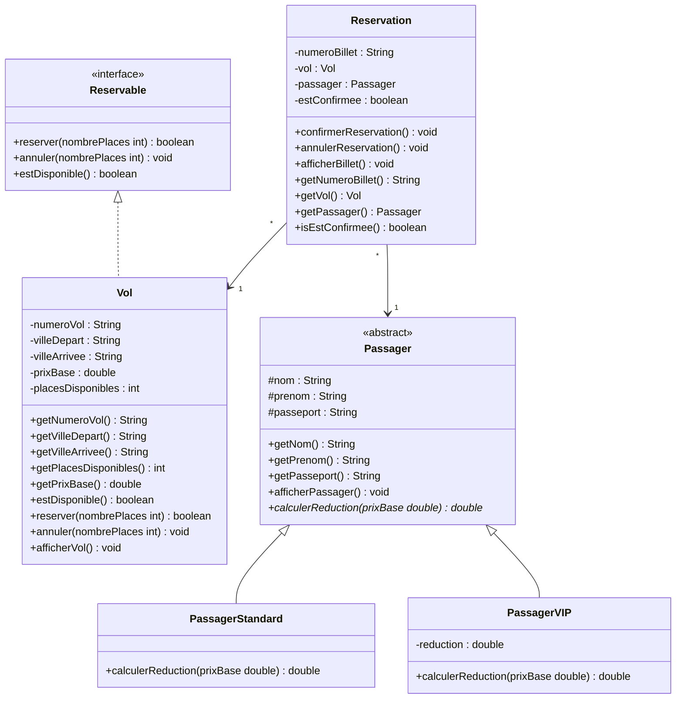

# Réservation de vols — Mini-projet POO (Java 17)

**Groupe :** Diabaté Fatoumata, Zare Lamine, Oualbeogo Julie, Traoré Tariq

## 1. But du projet

Ce programme Java, en console, gère des vols, des passagers et des réservations. On peut :

- créer des vols (numéro, villes, prix, nombre de places) ;
- créer des passagers, **standard** (prix normal) ou **VIP** (avec une réduction) ;
- réserver une place sur un vol, puis confirmer ou annuler la réservation ;
- afficher un billet avec le prix à payer ;
- savoir si un vol est disponible ou complet.

## 2. Les classes

| Classe | Rôle |
|---|---|
| `Reservable` (interface) | Dit ce que doit savoir faire tout ce qui peut être réservé : `reserver`, `annuler`, `estDisponible`. |
| `Vol` | Un vol avec ses places. Il implémente `Reservable`. |
| `Passager` (classe abstraite) | Ce qu'ont en commun tous les passagers : nom, prénom, passeport. Chaque type de passager calcule son prix. |
| `PassagerStandard` | Passager sans réduction : il paie le prix de base. |
| `PassagerVIP` | Passager avec une réduction (par exemple 0.20 pour 20 %). |
| `Reservation` | Relie **un vol** et **un passager**. Elle peut être confirmée ou annulée. |
| `Main` | Lance les scénarios de test. |

**Polymorphisme :** `calculerReduction` est écrite dans `Passager` et chaque sous-classe la remplit à sa façon. Un passager standard paie 300000, un VIP à 20 % paie 240000, pour le même vol.

## 3. Diagramme UML



Une version image du diagramme est dans `docs/diagramme-uml.svg`.

## 4. Règles à respecter

- Un vol doit avoir un numéro, un prix supérieur à 0 et un nombre de places qui n'est pas négatif.
- Un passager doit avoir un nom, un prénom et un passeport.
- La réduction d'un VIP doit être entre 0 et 1 (sinon elle est mise à 0).
- On ne peut pas réserver 0 place ou un nombre négatif.
- On ne peut pas réserver sur un vol complet.
- Une réservation confirmée prend une seule place, et elle ne peut pas être confirmée deux fois.
- On ne peut annuler qu'une réservation déjà confirmée.

## 5. Compiler et lancer

Dans le dossier qui contient les fichiers `.java` :

```
javac *.java
java Main
```

## 6. Tests

Le `Main` simule les 3 cas demandés pour l'interface `Reservable` :

1. **Vol disponible** : on réserve 1 place sur un vol de 2 places, il en reste 1.
2. **Vol complet** : on prend la dernière place, le vol n'est plus disponible et une nouvelle réservation est refusée.
3. **Réservation refusée** : on demande 0 place, c'est refusé.

À la fin, le programme affiche le bilan. Résultat attendu : `BILAN : 3/3 tests réussis`.
Les vols sont rangés dans une `List<Vol>`, qu'on parcourt pour les afficher.

## 7. Répartition du travail

| Membre | Code | Autre tâche |
|---|---|---|
| Diabaté Fatoumata | `Vol.java`, `Reservable.java`, `Rédiger le README`  |
| Zare Lamine | `Passager.java`, `PassagerStandard.java` | 
| Oualbeogo Julie | `Reservation.java`,`Dessiner le diagramme UML` |
| Traoré Tariq | `Main.java` (les 3 scénarios), `PassagerVIP.java` |

Chaque membre fait ses commits sur ses propres fichiers.
