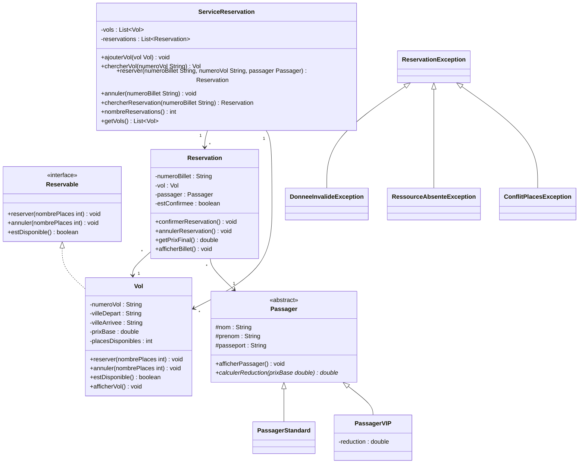

# Réservation de vols — Mini-projet POO (Java 17)

**Groupe G03 :** Diabaté Fatoumata, Zare Lamine, Oualbeogo Julie, Traoré Tariq

## 1. But du projet

Programme Java en console qui gère des vols (la ressource à réserver), des passagers et des réservations. On peut :

- créer des vols (numéro, villes, prix, nombre de places) ;
- créer des passagers **standard** ou **VIP** (avec une réduction) ;
- réserver et annuler une place grâce à un **service de réservation** ;
- afficher un billet avec le prix à payer ;
- recevoir une **erreur claire** quand la demande est impossible (vol complet, vol inconnu, donnée invalide), sans que rien ne soit enregistré à moitié.

## 2. Les classes

| Classe | Rôle |
|---|---|
| `Reservable` (interface) | Contrat de ce qui peut être réservé : `reserver`, `annuler`, `estDisponible`. |
| `Vol` | Un vol et ses places. Remplit `Reservable`. |
| `Passager` (abstraite) | Nom, prénom, passeport, et `calculerReduction` (prix à payer). |
| `PassagerStandard` | Paie le prix de base. |
| `PassagerVIP` | Paie le prix de base moins sa réduction (entre 0 et 1). |
| `Reservation` | Relie un vol et un passager ; se confirme et s'annule. |
| `ServiceReservation` | Point d'entrée : garde les vols et les réservations ; réserve et annule. |
| `ReservationException` | Erreur de base. Elle sert aussi aux erreurs d'état (confirmer deux fois, annuler ce qui n'est pas confirmé). |
| `DonneeInvalideException` | Donnée refusée : prix négatif, nom vide, 0 place, réduction hors bornes... |
| `RessourceAbsenteException` | Vol ou billet introuvable. |
| `ConflitPlacesException` | Pas assez de places (vol complet). |
| `Main` | Démonstration : un scénario et trois cas d'erreur. |

## 3. Diagramme UML



Une version image est dans `docs/diagramme-uml.svg`.

## 4. Règles à respecter (invariants)

- Un vol a un numéro, un prix supérieur à 0 et un nombre de places qui n'est pas négatif.
- Le nombre de places d'un vol ne devient jamais négatif.
- On ne réserve qu'un nombre de places strictement positif.
- La réduction d'un VIP est entre 0 et 1.
- Une réservation confirmée prend une seule place, une seule fois.
- On n'annule que ce qui est confirmé.
- **Atomicité :** après une erreur, rien n'est modifié à moitié. Le service n'enregistre une réservation que si la place a bien été prise.

## 5. Erreurs

| Situation | Exception |
|---|---|
| Prix négatif, nom vide, 0 place demandée, réduction hors de 0 à 1, billet déjà utilisé | `DonneeInvalideException` |
| Vol ou billet introuvable | `RessourceAbsenteException` |
| Vol complet ou trop de places demandées | `ConflitPlacesException` |
| Confirmer deux fois, annuler ce qui n'est pas confirmé | `ReservationException` |

## 6. Compiler et lancer

Dans le dossier `src/` :

```
javac *.java
java Main
```

`Main` affiche un scénario (deux réservations, une standard et une VIP), trois cas d'erreur (vol complet, vol inconnu, 0 place) puis une annulation.

## 7. Tests JUnit 5

Les tests sont dans le dossier `tests/` (35 tests, dont de nombreux cas d'échec qui vérifient aussi l'état après l'exception).

| Fichier | Partie testée | Tests |
|---|---|---|
| `VolTest` | `Vol` | 10 |
| `PassagerTest` | passagers | 7 |
| `ReservationTest` | `Reservation` | 9 |
| `ServiceReservationTest` | service et atomicité | 9 |

Pour les lancer : ouvrir le projet dans IntelliJ, Eclipse ou VS Code, ajouter JUnit 5 si l'éditeur le propose, puis « Run tests » sur le dossier `tests/`.

## 8. Répartition du travail

| Membre | Code | Tests | Autre tâche |
|---|---|---|---|
| Diabaté Fatoumata | `Vol`, `Reservable` | `VolTest` | README,tags  |
| Zare Lamine | `Passager`, `PassagerStandard`, `PassagerVIP`, les 4 exceptions | `PassagerTest` | Vérifier les prix à la main |
| Oualbeogo Julie | `Reservation` | `ReservationTest` | Diagramme UML |
| Traoré Tariq | `ServiceReservation`, `Main` | `ServiceReservationTest` | Vérifier la bonnes exécution des tests |

## 9. Jalons et tags

| Jalon | Contenu | Tag |
|---|---|---|
| 1 | Modèle et invariants | `jalon-1` |
| 2 | Composition et polymorphisme | `jalon-2` |
| 3 | Interfaces et collections | `jalon-3` |
| 4 | Exceptions, tests, recette | `jalon-4` puis `version-1.0` |

## 10. Limites

- `Vol` ne garde pas de capacité maximale : appelé directement, `annuler` pourrait dépasser le nombre de places d'origine. Passer par `ServiceReservation` évite ce cas.
- `Reservation` dépend de `Vol` et non de l'interface `Reservable`.
- Les données sont en mémoire seulement.
